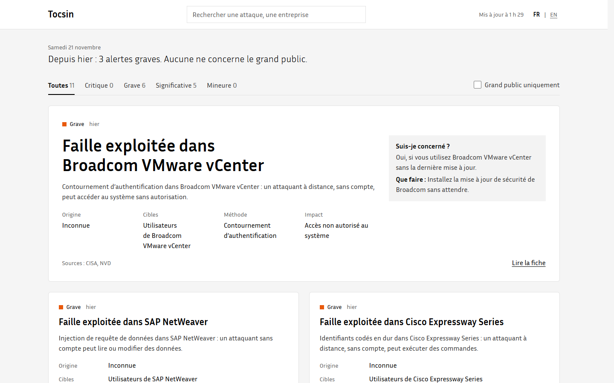

# Tocsin

*[English version: README.md](README.md)*

Un service d'information gratuit et ouvert, en français et en anglais, sur les cyberattaques qui
touchent le grand public et les entreprises. Tout ce que montre le site est réel : de vraies
failles et de vraies attaques, lues dans des sources fiables par un collecteur, chaque fiche avec
ses sources.



| Dossier | Ce que c'est |
|---|---|
| `collector/` | un programme Python qui lit les sources et écrit `frontend/public/data/cards.json` (voir `collector/README.md`) |
| `frontend/` | le site statique, qui affiche ce fichier et rien d'autre (voir `frontend/README.md`) |

**Sans aucune clé**, le collecteur lit le catalogue des failles exploitées de la CISA et les
alertes du CERT-FR. **Chaque clé ajoute une source** : Mistral, pour des articles de la presse
spécialisée lus par une IA ; ransomware.live, pour les revendications de rançongiciels visant des
organisations en France.

> **En toute honnêteté.** Les parties qui demandent une clé, la presse lue par Mistral et
> ransomware.live, ne sont testées qu'avec des réponses simulées. Aucun test, aucune vérification
> de ce dépôt n'a jamais appelé le vrai Mistral ni le vrai ransomware.live : chaque utilisateur
> apporte ses propres clés. Signalez tout ce qui ne marche pas avec elles (et, pour un problème de
> sécurité, voyez [SECURITY.md](SECURITY.md)).

## Avant de commencer

**Installez trois outils**, avec leurs options par défaut :

- [Git](https://git-scm.com/downloads) ;
- [Python 3.12 ou plus récent](https://www.python.org/downloads/). Sous Windows, sur le premier
  écran de l'installeur, **cochez « Add python.exe to PATH »** avant de cliquer sur « Install
  Now » ;
- [Node.js](https://nodejs.org/), la version LTS (20.19 ou plus récente).

**Ouvrez PowerShell** (Windows) : menu Démarrer, tapez « PowerShell », puis ouvrez « Windows
PowerShell » ; sous Windows 11, « Terminal » ouvre aussi PowerShell. Inutile de l'ouvrir en
administrateur. Sous Linux et macOS, ouvrez un terminal.

**Le dossier du projet** : PowerShell s'ouvre dans votre dossier personnel, que PowerShell appelle
`$HOME`. Le projet y sera créé, dans un dossier `tocsin` : `$HOME\tocsin`. Évitez le Bureau et les
Documents s'ils sont synchronisés par OneDrive : il y aurait des milliers de fichiers
d'installation à envoyer.

**Vérifiez les installations** : chaque commande doit afficher une version, Python 3.12 ou plus
récent et Node.js v20.19 ou plus récent. Si l'une répond « … n'est pas reconnu … », voyez
[Problèmes fréquents](#problèmes-fréquents).

```powershell
git --version
py --version
node --version
```

(`python3 --version` au lieu de `py --version` sous Linux et macOS.)

**`npm.cmd` et `npx.cmd`** : sous Windows, ce README écrit `npm.cmd` et `npx.cmd` au lieu de `npm`
et `npx`. PowerShell refuse souvent de lancer ces deux commandes (« l'exécution de scripts est
désactivée sur ce système »), car il les trouve d'abord sous forme de scripts PowerShell ; les
versions `.cmd` font exactement la même chose, sans ce blocage.

## Démarrage rapide, sans aucune clé

Tapez ces commandes une par une, en attendant la fin de chacune.

**Windows (PowerShell)**

```powershell
git clone https://github.com/Puchopuch/tocsin.git
cd tocsin
py -3 -m venv .venv
.venv\Scripts\python -m pip install -r requirements-dev.txt
.venv\Scripts\python -m collector run
cd frontend
npm.cmd ci
npm.cmd run dev
```

**Linux et macOS**

```sh
git clone https://github.com/Puchopuch/tocsin.git
cd tocsin
python3 -m venv .venv
.venv/bin/python -m pip install -r requirements-dev.txt
.venv/bin/python -m collector run
cd frontend
npm ci
npm run dev
```

Ouvrez ensuite <http://127.0.0.1:5173> (ou l'adresse affichée après `Local:`) : les fiches des sept
derniers jours, de la CISA et du CERT-FR. Le serveur de développement ne répond qu'à cet
ordinateur, jamais au réseau local. Arrêtez-le avec Ctrl+C.

## Les fois suivantes

Ouvrez PowerShell, collectez, puis lancez le site :

```powershell
cd $HOME\tocsin
.venv\Scripts\python -m collector run
cd frontend
npm.cmd run dev
```

Sous Linux et macOS : `cd ~/tocsin`, `.venv/bin/python -m collector run`, `cd frontend`,
`npm run dev`.

La collecte se lance **à la racine** du projet (le dossier `tocsin`), le site **dans son
sous-dossier `frontend`** : depuis `frontend`, `cd ..` remonte à la racine. Après une mise à jour
du projet (`git pull`), relancez aussi les deux installations :
`.venv\Scripts\python -m pip install -r requirements-dev.txt` à la racine, `npm.cmd ci` dans
`frontend`.

## Problèmes fréquents

- **`npm` ou `npx` refusé** (« Impossible de charger le fichier …\npm.ps1, car l'exécution de
  scripts est désactivée sur ce système ») : tapez `npm.cmd` ou `npx.cmd`, comme partout dans ce
  README.
- **`py`, `python`, `git` ou `node` « n'est pas reconnu »** : l'outil n'est pas installé, ou
  PowerShell était déjà ouvert pendant l'installation : fermez-le et rouvrez-le. Si `py` manque
  encore, relancez l'installeur de Python, choisissez « Modify », vérifiez que « py launcher » est
  coché, puis cochez « Add Python to environment variables » à l'écran suivant.
- **Ubuntu : « ensurepip is not available »** en créant `.venv` : installez le module manquant
  (`sudo apt install python3-venv`), supprimez le dossier `.venv` à moitié créé (`rm -rf .venv`),
  puis recommencez.
- **macOS : `python3 --version` affiche une version plus ancienne que 3.12** (celle des outils
  d'Apple) : installez Python depuis [python.org](https://www.python.org/downloads/) ou avec
  Homebrew (`brew install python@3.12`), puis créez `.venv` avec `python3.12 -m venv .venv`.
- **Le port 5173 est déjà pris** : le site prend le suivant et l'affiche après `Local:` (par
  exemple <http://127.0.0.1:5174>) ; ouvrez cette adresse.
- **Le bilan dit « échec, … ConnectError »** (ou `ConnectTimeout`, `ReadTimeout`) : la source n'a
  pas répondu. Vérifiez votre connexion Internet, un pare-feu (il doit laisser sortir Python) ou
  un proxy : le collecteur ne passe volontairement par aucun proxy ; sur un réseau qui en impose
  un (entreprise, école), collectez depuis une autre connexion.
- **Le site est vide après une collecte ratée** (« Aucune attaque recensée pour le moment ») : la
  première collecte a échoué avant d'écrire la moindre fiche. Lisez son bilan, réglez la cause,
  relancez la collecte, puis rechargez la page. Une source en panne n'efface jamais les fiches
  déjà écrites.

## Les clés, pas à pas

Les deux clés sont facultatives et gratuites. Elles vont dans un fichier nommé `.env`, à la racine
du dépôt, que Git ignore.

| Clé | Ce qu'elle ajoute | Sans elle |
|---|---|---|
| `MISTRAL_API_KEY` | des articles de BleepingComputer, The Record, ZATAZ et LeMagIT lus par une IA (Mistral), et les textes de la CISA traduits en français | la presse n'est pas lue ; les fiches de la CISA et du CERT-FR sont là |
| `RANSOMWARE_LIVE_API_KEY` | les revendications de rançongiciels visant des organisations en France, affichées « Revendiqué, non confirmé » | aucune revendication |

### 1. Créer les clés

- **Mistral** : sur <https://console.mistral.ai>, créez un compte ou connectez-vous. La console
  change souvent, ses offres aussi. Si elle vous propose un abonnement, cherchez plutôt l'option
  qui active l'accès à l'API sur l'offre gratuite. Fixez ensuite une limite de dépenses à 0, pour
  qu'aucun appel ne soit jamais facturé. Créez enfin la clé, dans la rubrique des clés d'API, et
  copiez-la tout de suite : elle ne s'affiche qu'une fois. **Sur l'offre gratuite, Mistral peut
  utiliser vos requêtes pour entraîner ses modèles** : le collecteur ne lui envoie que des
  articles de presse publics et des textes publics de la CISA, jamais rien de privé. N'utilisez
  pas cette clé pour des données privées. Lisez avant les conditions actuelles de Mistral.
- **ransomware.live** : sur <https://my.ransomware.live>, créez un compte, puis générez votre jeton
  pour l'API PRO. Au moment où ce texte est écrit, l'API PRO est gratuite, avec 3 000 appels par
  jour ; une collecte en fait un ou deux. Lisez avant leurs conditions actuelles.

Gardez chaque clé dans un gestionnaire de mots de passe.

### 2. Les mettre dans `.env`

Créez `.env` à partir du modèle, **sans écraser un `.env` qui existe déjà**, puis ouvrez-le.

**Windows (PowerShell)**, à la racine du dépôt :

```powershell
if (-not (Test-Path .env)) { Copy-Item .env.example .env }
notepad .env
```

**Linux et macOS** :

```sh
[ -e .env ] || cp .env.example .env
nano .env
```

Collez chaque clé juste après son signe `=`, **sans espace ni guillemets**, puis enregistrez :

```
MISTRAL_API_KEY=votre-clé-mistral
RANSOMWARE_LIVE_API_KEY=votre-jeton-ransomware-live
```

### 3. Les vérifier

```powershell
.venv\Scripts\python -m collector check-sources
```

(`.venv/bin/python` sous Linux et macOS.) Pour chaque source, si elle répond ; pour chaque clé,
`absente`, `valide` ou `refusée`, jamais la clé elle-même. Pour Mistral, il dit aussi si le modèle
demandé par le collecteur est toujours proposé.

### 4. Collecter

```powershell
.venv\Scripts\python -m collector run
```

Une clé absente ou refusée n'arrête jamais la collecte : sa source est sautée avec un message
clair, et les autres sources mettent quand même le site à jour.

### Les garder secrètes

- `.env` figure dans `.gitignore` : `git status` ne doit jamais le montrer. Ne le commitez jamais,
  et ne collez jamais une clé dans une issue, une pull request, une conversation ou une capture.
- Le collecteur n'affiche, ne journalise ni ne stocke jamais une clé : il la garde comme valeur
  secrète, ne l'envoie qu'à sa propre API, jamais à travers une redirection.
- **Si une clé fuit** : supprimez-la tout de suite là où vous l'avez créée (console Mistral ;
  my.ransomware.live), créez-en une nouvelle, mettez-la dans `.env`, et lancez `check-sources`.

## Commandes

À la racine du dépôt (ici pour Windows ; `.venv/bin/python` ailleurs) :

```powershell
.venv\Scripts\python -m collector check-sources       # chaque source répond-elle ? état de chaque clé
.venv\Scripts\python -m collector run                 # une collecte complète
.venv\Scripts\python -m collector run --phase 1       # sans IA, même avec une clé Mistral
.venv\Scripts\python -m collector run --dry-run       # n'écrit rien, montre ce qui serait écrit
.venv\Scripts\python -m collector run --max-ai-calls 10
.venv\Scripts\python -m collector validate            # vérifie le cards.json existant
```

Chaque collecte finit par un bilan : entrées lues par source, fiches retenues par niveau et par
source, fiches rejetées avec leur raison, fiches mises de côté, appels à l'IA faits et restants, et
ce qu'est devenu `cards.json`. Le site n'a qu'un mode : `npm run dev` et `npm run build` lisent les
vraies fiches ; sans collecte, il dit « Aucune attaque recensée pour le moment ».

## Collecter régulièrement

Le site ne montre que la dernière collecte. Pour qu'il reste à jour, collectez quelques fois par
jour, par exemple à 7 h, 13 h et 19 h : les sources changent quelques fois par jour, et le
collecteur réutilise les réponses qu'il a déjà (ETag, Last-Modified) ; collecter plus souvent
n'apporte rien. Avec `npm run dev`, rechargez la page pour voir les nouvelles fiches ; un site
construit avec `npm run build` montre celles du moment de sa construction : reconstruisez-le après
la collecte.

**Windows** : une tâche du Planificateur de tâches, créée depuis PowerShell à la racine du dépôt
(`pythonw` lance le collecteur sans ouvrir de fenêtre) :

```powershell
$root = (Get-Location).Path
$action = New-ScheduledTaskAction -Execute "$root\.venv\Scripts\pythonw.exe" -Argument '-m collector run' -WorkingDirectory $root
$times = '07:00', '13:00', '19:00' | ForEach-Object { New-ScheduledTaskTrigger -Daily -At $_ }
Register-ScheduledTask -TaskName 'Tocsin' -Action $action -Trigger $times
```

La tâche tourne quand votre session est ouverte. Le Planificateur affiche le résultat de la
dernière exécution (0 : réussie, 1 : une source a échoué). Pour la retirer :
`Unregister-ScheduledTask -TaskName 'Tocsin'`.

**Linux et macOS** : `crontab -e`, puis cette ligne, avec le chemin de votre clone :

```
0 7,13,19 * * * cd "$HOME/tocsin" && mkdir -p collector/logs && .venv/bin/python -m collector run >> collector/logs/runs.log 2>&1
```

Sous macOS, cron ne peut pas ouvrir le Bureau, les Documents ni les Téléchargements sans « Accès
complet au disque » : placez le clone ailleurs, dans votre dossier personnel par exemple. Une
collecte où une source échoue garde les fiches précédentes (voir « Les règles que le code
applique »).

## Où vont les données

| Fichier | Ce qu'il contient | Dans Git |
|---|---|---|
| `frontend/public/data/cards.json` | les fiches de la dernière collecte, lues par le site | non : il nomme de vraies organisations |
| `collector/state.db` | un cache : les réponses des sources (ETag, Last-Modified) et celles de l'IA, 30 jours | non |
| `collector/logs/collector.log` | le journal local : noms mis de côté, fiches rejetées et pourquoi | non |
| `.env` | vos clés | jamais |

Rien n'est envoyé ailleurs : ni statistique, ni compte, ni cookie.

## Comment ça marche

### Phase 1, sans IA

| Source | Ce qui est pris | Fiche |
|---|---|---|
| CISA, Known Exploited Vulnerabilities | les failles ajoutées ces 7 derniers jours | « Grave » dans un logiciel répandu, sinon « Significative » |
| CERT-FR, alertes | les alertes des 7 derniers jours, avec les CVE, systèmes affectés et risques de leur page | rejoint la fiche de la CISA de la même CVE, sinon sa propre fiche « Grave » |
| API PRO de ransomware.live (clé) | les revendications visant des organisations en France, des 7 derniers jours | « Significative » au plus, « Revendiqué, non confirmé » |

Chaque fiche est faite de phrases fixes remplies avec les champs de sa source, en français et en
anglais (`collector/cards.py`, `collector/flaws.py`). Ce qu'une source ne dit pas reste vide, et le
site affiche « Non communiqué ».

- **CISA, méthode** : le type de faille, d'après le nom que lui donne la CISA (« Code Injection »,
  « Path Traversal »…) ou ses numéros CWE, par une table fixe.
- **CISA, impact** : la conséquence que la description nomme (exécution de code, élévation de
  privilèges, accès non autorisé, fuite de données, déni de service…), « à distance » seulement si
  le texte le dit ; qui peut exploiter la faille est lu dans la même phrase.
- **CISA, origine** : « Utilisée par des rançongiciels, selon la CISA » quand le catalogue le dit.
- **CERT-FR** : cibles et impact d'après les listes « Systèmes affectés » et « Risques » de l'alerte.
- **Résumé** : une phrase courte propre à chaque fiche, puis la date.
- **Nature** : une faille ou une attaque ; la phrase du jour dit « alertes », sauf si toutes les
  fiches comptées sont des attaques.
- **Français et anglais** : chaque phrase fixe existe dans les deux langues ; aucun service de
  traduction. Un titre du CERT-FR de forme inhabituelle reste en français dans la version anglaise,
  et il est signalé.

### Phase 2, avec une clé Mistral : l'IA lit, le code juge

Les articles des 7 derniers jours qui parlent d'une attaque, du plus récent au plus ancien
(`collector/press.py`) :

1. L'article est lu sur sa page quand le robots.txt l'autorise, **texte visible seulement** (ni
   commentaire, ni attribut, ni script, ni élément caché, ni caractère invisible), sinon le résumé
   du flux ; coupé à 8 000 caractères.
2. **Premier appel** : l'IA extrait des faits, chacun avec une citation de 3 à 25 mots. Le code ne
   garde un fait que si sa citation est dans l'article **mot pour mot**, après normalisation des
   espaces, apostrophes, guillemets et tirets (jamais approximativement), et dit ce que dit le
   fait. Un pays n'est gardé que si la citation nomme une autorité d'une liste fermée (ANSSI,
   CERT-FR, CISA, FBI, NCSC, Europol, un gouvernement…).
3. **Le code** fixe le niveau à partir des faits gardés, les statuts, le public, les liens et les
   dates. Une victime qui pourrait être une personne est mise de côté.
4. **Second appel** : l'IA rédige la fiche en français et en anglais **à partir des seuls faits
   gardés, jamais de l'article**. Un texte qui contient un lien, un e-mail, un numéro de téléphone,
   un IBAN, une adresse de portefeuille, ou un chiffre absent des faits, est refusé ; trop long, il
   est redemandé une fois.
5. Avec les appels restants, l'IA traduit en français les textes de la CISA, sans rien ajouter.

**Chaque fiche rédigée ou traduite par l'IA le dit sur la fiche elle-même**, et garde le modèle
daté (`MISTRAL_MODEL` dans `collector/config.py`, jamais « -latest ») et la version des consignes
(`collector/prompts/`). Au plus 40 appels par collecte, les articles les plus récents d'abord ;
après une erreur HTTP 429, une attente croissante puis un arrêt propre ; une réponse est gardée
30 jours, pour que le même texte ne coûte jamais un second appel. Les **doublons** sont réunis :
une fiche de presse qui cite la CVE d'une fiche de la CISA ou du CERT-FR la rejoint ; les fiches de
presse et les revendications sur la même victime à 7 jours près n'en font qu'une, avec toutes
leurs sources.

### Ce que reçoit l'IA

Seulement les consignes (`collector/prompts/`) et le texte à lire : le texte visible d'un article
de presse public, puis les faits gardés, ou un texte public de la CISA. Aucune adresse, aucun nom
de site, aucune clé, rien sur vous ni sur votre ordinateur.

### Les règles que le code applique

- Rien d'inventé : chaque information vient d'une source ; une information absente reste absente.
- Liens : https seulement, chaque source vers son propre domaine ; jamais `javascript:`, `data:`,
  un nom `.onion` ou `xn--`, une adresse IP, des identifiants ou un port. Jamais de lien vers le
  site d'un groupe de rançongiciel.
- Une revendication ne dépasse jamais « Significative » tant que la victime ne l'a pas confirmée.
- Longueurs, dans chaque langue : titre de 10 mots ; victime, méthode et impact de 45 caractères ;
  « Suis-je concerné ? » et « Que faire » de 75.
- Aucune donnée personnelle : ni e-mail, ni numéro de téléphone, ni IBAN, ni adresse de
  portefeuille dans une fiche ; une victime qui pourrait être une personne est mise de côté, son
  nom écrit seulement dans le journal local.
- Une panne ne vide jamais le site : si une source échoue, les fiches et l'heure de la dernière
  collecte complète restent. Le fichier est écrit dans un fichier temporaire, puis renommé.

## Sécurité

- **Requêtes** : https seulement, vers les sites prévus seulement (`ALLOWED_HOSTS`), à des
  adresses publiques seulement (vérifiées après le DNS, à chaque redirection et sur la connexion
  elle-même), TLS toujours vérifié, 3 redirections au plus, 20 s par opération réseau et 60 s par
  requête, 20 Mo au plus une fois décompressé (une bombe de compression s'arrête à la limite).
- **Entrées** : XML lu avec defusedxml et sans DTD (ni XXE, ni « billion laughs ») ; HTML lu par
  un parseur, jamais par des expressions régulières, dans le collecteur comme dans les
  vérifications du site ; entrées cassées écartées et comptées ; caractères de contrôle,
  invisibles et bidirectionnels retirés ; chaque requête SQLite avec des paramètres.
- **Clés** : gardées comme valeurs secrètes, envoyées à leur propre API seulement, jamais à travers
  une redirection, jamais journalisées ni mises en cache.
- **Site** : une Content-Security-Policy sans script en ligne ni eval, Trusted Types exigés, liens
  revérifiés, fichier de plus de 5 Mo refusé, serveurs de développement et de prévisualisation sur
  127.0.0.1 seulement.
- **Tests** : `collector/tests/test_network.py`, `test_inputs.py`, `test_secrets_resilience.py`,
  `test_phase2.py`, et les vérifications de sécurité de `npm run check`.
- **À chaque push** (GitHub Actions, `.github/workflows/ci.yml`), sans clé ni secret et avec des
  droits en lecture seule : pytest, sous Python 3.12 et sous la dernière version stable de Python,
  `npm run check`, gitleaks sur tout l'historique, pip-audit,
  `npm audit` et Bandit. Les actions sont épinglées par commit. Chaque semaine, Dependabot propose
  une pull request pour toutes les mises à jour de pip, une pour toutes celles de npm, et celles
  des actions, quand les versions ont 14 jours ; les correctifs de sécurité tout de suite.

Pour signaler un problème de sécurité, voyez [SECURITY.md](SECURITY.md) : en privé, jamais dans
une issue publique.

## Tests

```powershell
.venv\Scripts\python -m pytest
cd frontend
npx.cmd playwright install chromium   # une fois
npm.cmd run check
```

Les tests n'atteignent jamais le réseau ni un serveur DNS, et ne touchent jamais à votre `.env`, à
`state.db`, au journal ni à `cards.json`. Les échantillons de la CISA et du CERT-FR sont de vrais
extraits ; les articles de presse, les réponses de ransomware.live et celles de l'IA sont inventés,
noms compris. `npm run check` construit le site, puis le parcourt dans un navigateur en français et
en anglais, avec des fiches de test. Au lieu de télécharger Chromium, il peut utiliser le Chrome
déjà installé : `$env:CHECK_BROWSER = 'chrome'` sous PowerShell, ou
`CHECK_BROWSER=chrome npm run check` ailleurs.

Les audits de la CI, à la main (sous Linux et macOS, `.venv/bin/python`) :

```powershell
.venv\Scripts\python -m pip install -r requirements-audit.txt
.venv\Scripts\python -m pip_audit --strict --no-deps --disable-pip -r requirements.txt -r requirements-dev.txt -r requirements-audit.txt
.venv\Scripts\python -m bandit -r collector -x collector/tests
cd frontend
npm.cmd audit --audit-level=high
```

## Limites

- Tocsin **n'est pas un service officiel**. Les fiches sont construites automatiquement : si une
  source se trompe, la fiche aussi. **Vérifiez toujours la source** avant d'agir.
- L'IA peut se tromper : le code ne garde que ce qu'une citation prouve et décide lui-même du
  niveau, mais une fiche rédigée par l'IA le dit, et ses sources sont à un clic.
- Ce n'est pas du direct : les données sont celles de la dernière collecte, dont le site affiche
  l'heure.
- La presse et ransomware.live ne sont testées qu'avec des réponses simulées (voir plus haut).

## Licence et crédits

Le code est sous [licence MIT](LICENSE), © 2026 Puchopuch.

Les informations viennent de la [CISA](https://www.cisa.gov/known-exploited-vulnerabilities-catalog)
(Known Exploited Vulnerabilities), du [CERT-FR](https://cert.cyber.gouv.fr/), de la
[NVD](https://nvd.nist.gov/), de [ransomware.live](https://www.ransomware.live/) et de la presse
(BleepingComputer, The Record, ZATAZ, LeMagIT) : elles leur appartiennent. Chaque fiche renvoie à
ses sources ; aucun article n'est republié. Les textes de l'IA sont écrits par des modèles de
[Mistral AI](https://mistral.ai/), avec votre clé. La police est
[Inria Sans](https://github.com/BlackFoundryCom/InriaFonts) (SIL Open Font License), servie par
[Fontsource](https://fontsource.org/).

Le dragon, emblème de Tocsin, est une gravure sur bois d'Ulisse Aldrovandi, *Serpentum et
draconum historiae libri duo* (Bologne, 1640), **domaine public** :
[Wikimedia Commons](https://commons.wikimedia.org/wiki/File:Dragon_2_Aldrovdani.jpg), numérisée
par les Smithsonian Libraries pour la Biodiversity Heritage Library. Recadrée, avec un fond
transparent et des traits gris foncé, elle est stockée dans le dépôt
(`frontend/src/assets/dragon-aldrovandi.webp`) et jamais chargée depuis un autre site.
