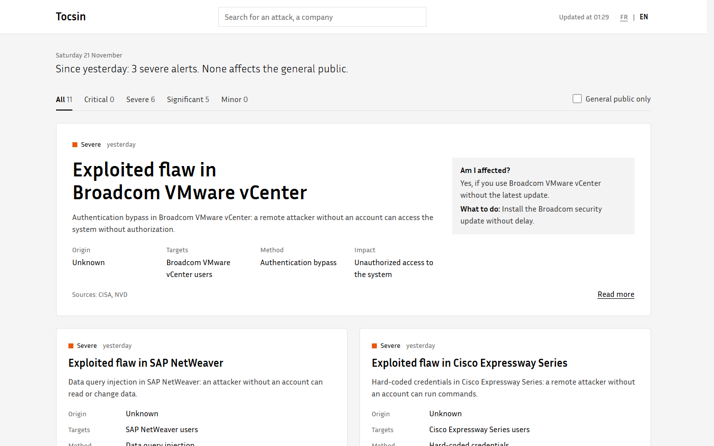

# Tocsin

*[Version française : README.fr.md](README.fr.md)*

A public information service, in French and in English, about the cyberattacks that touch the
general public and businesses. Everything on the site is real: real flaws and attacks, read from
reliable sources by a collector, each card with its sources. **Tocsin** is a provisional name
(`APP_NAME` in `frontend/src/config.js`).



| Folder | What it is |
|---|---|
| `collector/` | a Python program that reads the sources and writes `frontend/public/data/cards.json` (see `collector/README.md`) |
| `frontend/` | the static site, which shows that file and nothing else (see `frontend/README.md`) |

**Without any key**, the collector reads the CISA catalogue of exploited flaws and the alerts of
the CERT-FR. **Each key adds a source**: Mistral, for articles of the specialised press read by an
AI; ransomware.live, for the ransomware claims against organisations in France.

> **Honestly.** The parts that need a key, the press read by Mistral and ransomware.live, are
> tested with simulated answers only. No test, and no check of this repository, ever called the
> real Mistral or the real ransomware.live: each user brings their own keys. Report anything that
> goes wrong with them (see [SECURITY.md](SECURITY.md) for a security problem).

## Quick start, without any key

You need [Git](https://git-scm.com/), [Python 3.12 or newer](https://www.python.org/downloads/) and
[Node.js 20.19 or newer](https://nodejs.org/).

**Windows (PowerShell)**

```powershell
git clone https://github.com/Puchopuch/tocsin.git
cd tocsin
py -3.12 -m venv .venv
.venv\Scripts\python -m pip install -r requirements-dev.txt
.venv\Scripts\python -m collector run
cd frontend
npm ci
npm run dev
```

**Linux and macOS**

```sh
git clone https://github.com/Puchopuch/tocsin.git
cd tocsin
python3 -m venv .venv
.venv/bin/python -m pip install -r requirements-dev.txt
.venv/bin/python -m collector run
cd frontend
npm ci
npm run dev
```

Then open <http://127.0.0.1:5173>: the cards of the last seven days, from the CISA and the
CERT-FR. The dev server answers this computer only, never the local network. Stop it with Ctrl+C.

## Keys, step by step

Both keys are optional and free. They go in a file named `.env`, at the root of the repository,
which Git ignores.

| Key | What it adds | Without it |
|---|---|---|
| `MISTRAL_API_KEY` | articles of BleepingComputer, The Record, ZATAZ and LeMagIT read by an AI (Mistral), and the CISA texts translated into French | the press is not read; the CISA and CERT-FR cards are there |
| `RANSOMWARE_LIVE_API_KEY` | ransomware claims against organisations in France, shown as "Claimed, not confirmed" | no claim |

### 1. Create the keys

- **Mistral**: on <https://console.mistral.ai>, sign in, open **API Keys**, then **Create new key**.
  Copy the key at once: it is shown only once. The free plan ("Experiment") asks for a phone
  number, not a bank card. **On the free plan, Mistral may use your requests to train its
  models**: the collector sends it only public press articles and public CISA texts, never
  anything private. Do not use this key for private data. Read Mistral's current terms before.
- **ransomware.live**: on <https://my.ransomware.live>, create an account, then generate your
  token for the PRO API. When this was written, the PRO API was free, with 3,000 calls a day; a
  collection makes one or two. Read their current terms before.

Keep each key in a password manager.

### 2. Put them in `.env`

Create `.env` from the template, **without overwriting a `.env` that already exists**, then open it.

**Windows (PowerShell)**, at the root of the repository:

```powershell
if (-not (Test-Path .env)) { Copy-Item .env.example .env }
notepad .env
```

**Linux and macOS**:

```sh
[ -e .env ] || cp .env.example .env
nano .env
```

Paste each key right after its `=` sign, **without spaces or quotes**, then save:

```
MISTRAL_API_KEY=your-mistral-key
RANSOMWARE_LIVE_API_KEY=your-ransomware-live-token
```

### 3. Check them

```powershell
.venv\Scripts\python -m collector check-sources
```

(`.venv/bin/python` on Linux and macOS.) For each source, whether it answers; for each key,
`absente` (missing), `valide` (accepted) or `refusée` (refused), never the key itself. For
Mistral, it also says whether the model the collector asks for is still offered.

### 4. Collect

```powershell
.venv\Scripts\python -m collector run
```

A missing or refused key never stops the collection: its source is skipped with a clear message,
and the other sources still update the site.

### Keep them secret

- `.env` is listed in `.gitignore`: `git status` must never show it. Never commit it, and never
  paste a key in an issue, a pull request, a chat or a screenshot.
- The collector never prints, logs or stores a key: it holds it as a secret value, sends it only
  to its own API, never through a redirect.
- **If a key leaks**: delete it at once where you created it (Mistral console, **API Keys**;
  my.ransomware.live), create a new one, put it in `.env`, and run `check-sources`.

## Commands

From the root of the repository (Windows shown; `.venv/bin/python` elsewhere):

```powershell
.venv\Scripts\python -m collector check-sources       # does each source answer? state of each key
.venv\Scripts\python -m collector run                 # a full run
.venv\Scripts\python -m collector run --phase 1       # without AI, even with a Mistral key
.venv\Scripts\python -m collector run --dry-run       # writes nothing, shows what would be written
.venv\Scripts\python -m collector run --max-ai-calls 10
.venv\Scripts\python -m collector validate            # checks the existing cards.json
```

Each run ends with a summary: entries read per source, cards kept by level and by source, cards
rejected with their reason, cards held back, AI calls made and left, and what happened to
`cards.json`. The site has one mode only: `npm run dev` and `npm run build` read the real cards;
without a collection, it says "Aucune attaque recensée pour le moment" ("No attack recorded at the
moment").

## Collect regularly

The site shows the last collection only. To keep it current, collect a few times a day, for
instance at 7:00, 13:00 and 19:00: the sources change a few times a day, and the collector reuses
the answers it already has (ETag, Last-Modified), so collecting more often brings nothing. With
`npm run dev`, reload the page to see the new cards; a site built with `npm run build` shows those
of the moment it was built: build it again after the collection.

**Windows**: a task of the Task Scheduler, created from PowerShell at the root of the repository
(`pythonw` runs the collector without opening a window):

```powershell
$root = (Get-Location).Path
$action = New-ScheduledTaskAction -Execute "$root\.venv\Scripts\pythonw.exe" -Argument '-m collector run' -WorkingDirectory $root
$times = '07:00', '13:00', '19:00' | ForEach-Object { New-ScheduledTaskTrigger -Daily -At $_ }
Register-ScheduledTask -TaskName 'Tocsin' -Action $action -Trigger $times
```

The task runs while you are signed in. The Task Scheduler shows the result of the last run (0: done,
1: a source failed). To remove it: `Unregister-ScheduledTask -TaskName 'Tocsin'`.

**Linux and macOS**: `crontab -e`, then this line, with the path of your clone:

```
0 7,13,19 * * * cd "$HOME/tocsin" && mkdir -p collector/logs && .venv/bin/python -m collector run >> collector/logs/runs.log 2>&1
```

On macOS, cron cannot open the Desktop, Documents or Downloads folders without "Full Disk Access":
keep the clone elsewhere, in your home folder for instance. A run where a source fails keeps the
previous cards (see "Rules the code applies").

## Where the data goes

| File | What it holds | In Git |
|---|---|---|
| `frontend/public/data/cards.json` | the cards of the last collection, read by the site | no: it names real organisations |
| `collector/state.db` | a cache: the answers of the sources (ETag, Last-Modified) and those of the AI, 30 days | no |
| `collector/logs/collector.log` | the local journal: names held back, cards rejected and why | no |
| `.env` | your keys | never |

Nothing is sent anywhere else: no statistics, no account, no cookie.

## How it works

### Phase 1, without AI

| Source | Taken | Card |
|---|---|---|
| CISA, Known Exploited Vulnerabilities | flaws added in the last 7 days | "Severe" in widespread software, else "Significant" |
| CERT-FR, alerts | alerts of the last 7 days, with the CVE numbers, affected systems and risks of their page | joins the CISA card of the same CVE, else its own "Severe" card |
| ransomware.live PRO API (key) | claims against organisations in France, of the last 7 days | "Significant" at most, "Claimed, not confirmed" |

Every card is made of fixed sentences filled with fields of its source, in French and in English
(`collector/cards.py`, `collector/flaws.py`). What a source does not say stays empty, and the site
shows "Non communiqué" ("Not disclosed").

- **CISA, method**: the type of flaw, from the name the CISA gives it ("Code Injection", "Path
  Traversal"...) or its CWE numbers, through a fixed table.
- **CISA, impact**: the consequence the description names (code execution, privilege escalation,
  unauthorized access, data leak, denial of service...), "remote" only when the text says so; who
  can exploit the flaw is read in the same sentence.
- **CISA, origin**: "Utilisée par des rançongiciels, selon la CISA" when the catalogue says so.
- **CERT-FR**: targets and impact from the lists "Systèmes affectés" and "Risques" of the alert.
- **Summary**: one short sentence of its own per card, then the date.
- **Kind**: a flaw or an attack; the daily sentence says "alertes" unless every card counted is an
  attack.
- **French and English**: every fixed sentence exists in both languages; no translation service.
  A CERT-FR title in an unusual form stays in French in the English version, marked as such.

### Phase 2, with a Mistral key: the AI reads, the code judges

Articles of the last 7 days that speak of an attack, newest first (`collector/press.py`):

1. The article is read on its page when robots.txt allows it, **visible text only** (no comment,
   attribute, script, hidden element or invisible character), else the summary of the feed; cut
   to 8,000 characters.
2. **First call**: the AI extracts facts, each with a quote of 3 to 25 words. The code keeps a
   fact only when its quote is in the article **word for word**, after normalising spaces,
   apostrophes, quotes and dashes (never approximately), and says what the fact says. A country
   is kept only when the quote names an authority of a closed list (ANSSI, CERT-FR, CISA, FBI,
   NCSC, Europol, a government...).
3. **The code** sets the level from the facts kept, the statuses, the audience, the links and
   the dates. A victim that may be a person is held back.
4. **Second call**: the AI writes the card in French and in English **from the facts kept only,
   never from the article**. A text holding a link, an e-mail, a phone number, an IBAN, a wallet
   address, or a number that is not in the facts, is refused; too long, it is asked once more.
5. With the calls left, the AI translates the CISA texts into French, adding nothing.

**Every card written or translated by the AI says so on the card itself**, and keeps the dated
model (`MISTRAL_MODEL` in `collector/config.py`, never "-latest") and the version of the prompts
(`collector/prompts/`). At most 40 calls per run, newest articles first; after HTTP 429, a growing
wait then a clean stop; an answer is kept 30 days, so that the same text never costs a second
call. **Duplicates** are merged: a press card citing the CVE of a CISA or CERT-FR card joins it;
press cards and claims about the same victim within 7 days make one card, with all their sources.

### What the AI receives

Only the instructions (`collector/prompts/`) and the text to read: the visible text of a public
press article, then the facts kept, or a public text of the CISA. No address, no name of site, no
key, nothing about you or your computer.

### Rules the code applies

- Nothing invented: each piece of information comes from a source; a missing one stays missing.
- Links: https only, each source to its own domain; never `javascript:`, `data:`, a `.onion` or
  `xn--` name, an IP address, credentials or a port. Never a link to a ransomware group's site.
- A claim never goes above "Significant" while the victim has not confirmed it.
- Lengths, in each language: title of 10 words; victim, method and impact of 45 characters; "Am I
  affected?" and "What to do" of 75.
- No personal data: no e-mail, phone number, IBAN or wallet address in a card; a victim that may
  be a person is held back, its name written to the local journal only.
- A failure never empties the site: if a source fails, the previous cards and the time of the
  last complete collection stay. The file is written to a temporary file, then renamed.

## Security

- **Requests**: https only, to the listed sites only (`ALLOWED_HOSTS`), at public addresses only
  (checked after DNS, at each redirect, and on the connection itself), TLS always verified, 3
  redirects at most, 20 s per network operation and 60 s per request, 20 MB at most once
  decompressed (a compression bomb stops at the limit).
- **Inputs**: XML read with defusedxml and no DTD (no XXE, no billion laughs); HTML read by a
  parser, never by regular expressions, in the collector as in the checks of the site; broken
  entries skipped and counted; control, invisible and bidi characters removed; every SQLite query
  has placeholders.
- **Keys**: held as secret values, sent to their own API only, never through a redirect, never
  logged or cached.
- **Site**: a Content-Security-Policy without inline script or eval, Trusted Types required, links
  checked again, a file over 5 MB refused, dev and preview servers on 127.0.0.1 only.
- **Tests**: `collector/tests/test_network.py`, `test_inputs.py`, `test_secrets_resilience.py`,
  `test_phase2.py`, and the security checks of `npm run check`.
- **On every push** (GitHub Actions, `.github/workflows/ci.yml`), without any key or secret and
  with read-only rights: pytest, `npm run check`, gitleaks on the whole history, pip-audit,
  `npm audit` and Bandit. The actions are pinned by commit. Each week, Dependabot proposes one
  pull request for all the pip updates, one for all the npm updates, and the updates of the
  actions, once the versions are 14 days old; security fixes at once.

To report a security problem, see [SECURITY.md](SECURITY.md): privately, never in a public issue.

## Tests

```powershell
.venv\Scripts\python -m pytest
cd frontend
npx playwright install chromium   # once
npm run check
```

The tests never reach the network nor a DNS server, and never touch your `.env`, `state.db`,
journal or `cards.json`. The CISA and CERT-FR samples are real extracts; the press articles, the
ransomware.live answers and the answers of the AI are invented, names included. `npm run check`
builds the site, then drives a browser through it in French and in English, with test cards.
Instead of downloading Chromium, it can use the Chrome already installed:
`$env:CHECK_BROWSER = 'chrome'` in PowerShell, or `CHECK_BROWSER=chrome npm run check` elsewhere.

The audits of the CI, by hand (on Linux and macOS, `.venv/bin/python`):

```powershell
.venv\Scripts\python -m pip install -r requirements-audit.txt
.venv\Scripts\python -m pip_audit --strict --no-deps --disable-pip -r requirements.txt -r requirements-dev.txt -r requirements-audit.txt
.venv\Scripts\python -m bandit -r collector -x collector/tests
cd frontend
npm audit --audit-level=high
```

## Limits

- Tocsin is **not an official service**. The cards are built automatically: if a source is wrong,
  so is the card. **Always check the source** before acting.
- The AI can be wrong: the code keeps only what a quote proves and decides the level itself, but
  a card written by the AI says so, and its sources are one click away.
- It is not live: the data are those of the last collection, whose time the site shows.
- The press and ransomware.live parts are tested with simulated answers only (see above).

## Licence and credits

The code is under the [MIT licence](LICENSE), © 2026 Puchopuch.

The information comes from the [CISA](https://www.cisa.gov/known-exploited-vulnerabilities-catalog)
(Known Exploited Vulnerabilities), the [CERT-FR](https://cert.cyber.gouv.fr/), the
[NVD](https://nvd.nist.gov/), [ransomware.live](https://www.ransomware.live/) and the press
(BleepingComputer, The Record, ZATAZ, LeMagIT): it belongs to them. Each card links to its
sources; no article is republished. The texts of the AI are written by
[Mistral AI](https://mistral.ai/) models, with your key. The font is
[Inria Sans](https://github.com/BlackFoundryCom/InriaFonts) (SIL Open Font License), served by
[Fontsource](https://fontsource.org/).

The dragon, emblem of Tocsin, is a woodcut from Ulisse Aldrovandi, *Serpentum et draconum
historiae libri duo* (Bologna, 1640), **public domain**:
[Wikimedia Commons](https://commons.wikimedia.org/wiki/File:Dragon_2_Aldrovdani.jpg), scanned by
the Smithsonian Libraries for the Biodiversity Heritage Library. Cropped, with a transparent
background and dark grey lines, it is stored in the repository
(`frontend/src/assets/dragon-aldrovandi.webp`) and never loaded from another site.
